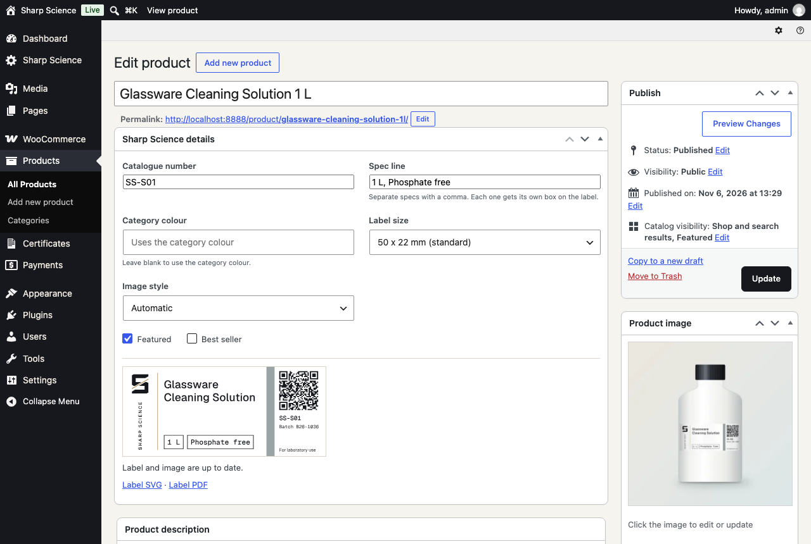
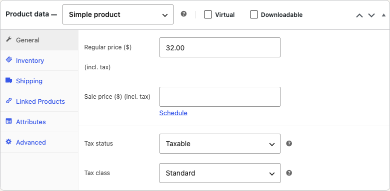
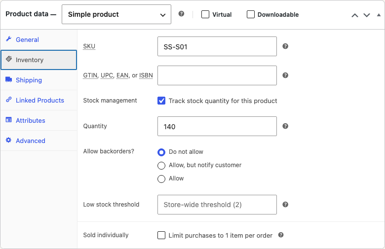
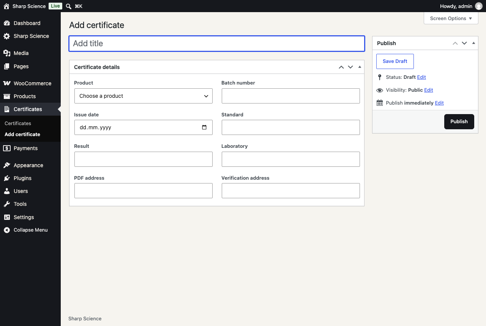
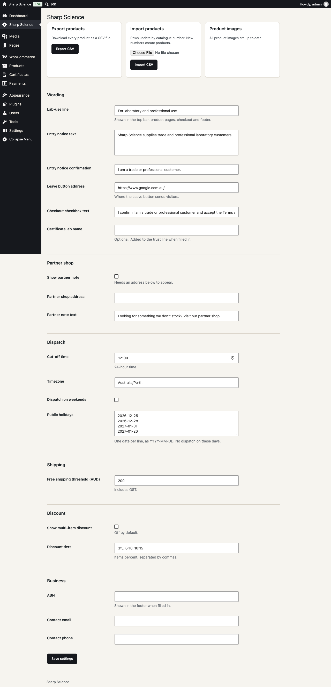

# Sharp Science client guide

Sign in at `/wp-admin`. Everything below needs no code.

## Add a product

1. Go to **Products > Add new product**.
2. Enter the product name.
3. In **Sharp Science details**, enter the catalogue number and spec line. Separate specs with a comma, such as `10 ml, Class A`.
4. Scroll to **Product data** and enter the price, including GST.
5. Tick a category in **Product categories**.
6. Click **Publish**.

The label, print PDF and product image are made for you. Keep the page open for a few seconds until it says "Label and image are up to date". The category tile and menu update by themselves.

To use your own photo, set it under **Product image**. It will not be replaced.

## Change a price

Open the product, change **Regular price** under **Product data > General**, then click **Update**.

To change many prices at once, go to **Sharp Science**, click **Export CSV**, edit the file, and use **Import CSV**. Rows match on catalogue number. Keep the Sharp Science page open until the images finish.

## Mark out of stock

Open the product and go to **Product data > Inventory**. Set **Quantity** to `0`, then click **Update**. The site shows "Out of stock" and removes the add button.

## Add a certificate

1. Go to **Certificates > Add certificate**.
2. Give it a title, such as `SS-V10 B26-1015`.
3. Choose the product and fill in the batch, date, standard, result and laboratory.
4. Upload the PDF under **Media**, copy its address, and paste it into **PDF address**.
5. Click **Publish**.

It appears on the Certificates page and the product page. The product's label and QR code move to this batch. Only list certificates you hold.

## Change the shipping threshold or cut-off

Go to **Sharp Science**, change the setting, then click **Save settings**.

| To change | Use this setting |
|---|---|
| Free shipping amount | Free shipping threshold |
| Daily cut-off | Cut-off time, in 24-hour time |
| Weekend dispatch | Dispatch on weekends |
| Public holidays | Public holidays, one date per line |
| Lab-use wording | Lab-use line |

The Express Post price is under **WooCommerce > Settings > Shipping > Australia**. Enter it excluding GST.
