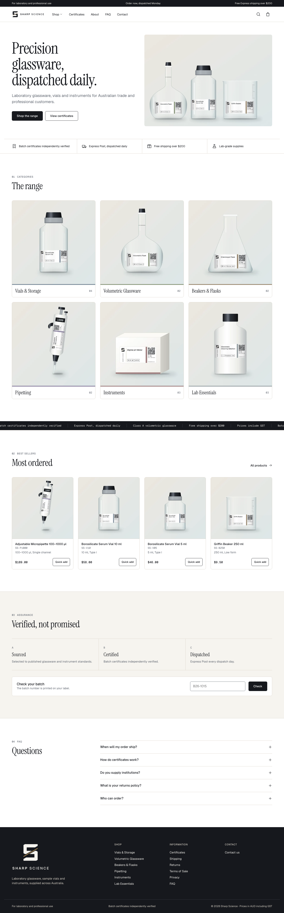
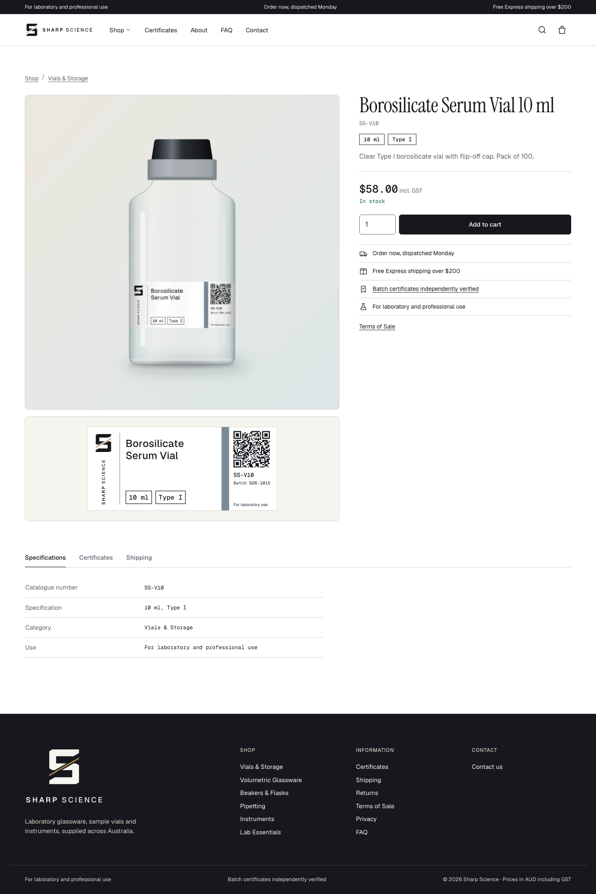
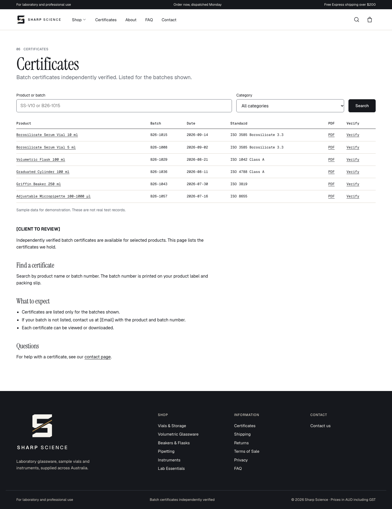
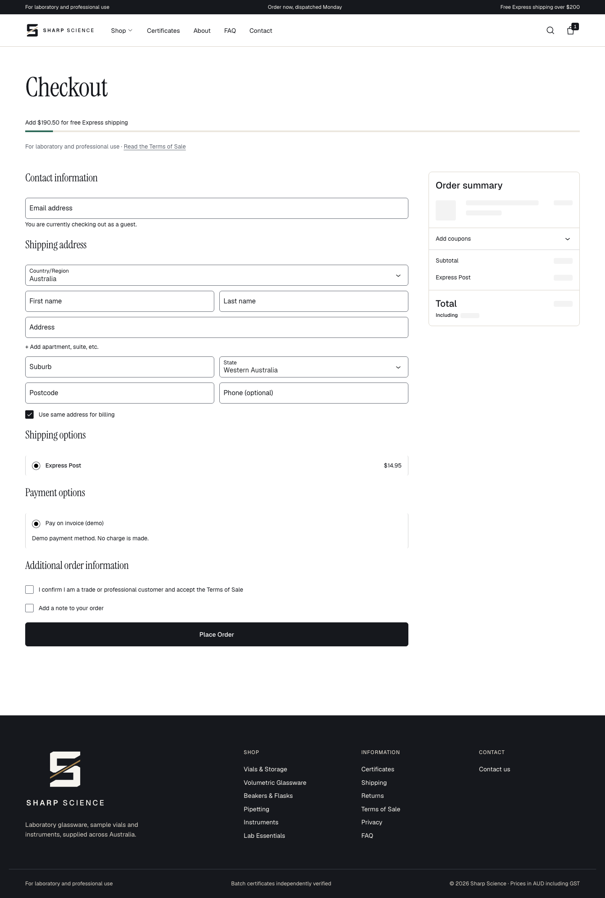
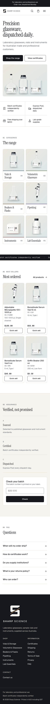
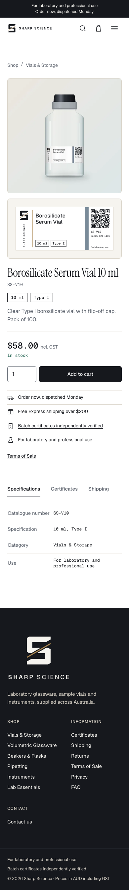
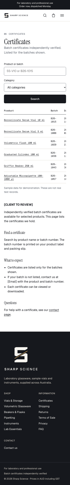
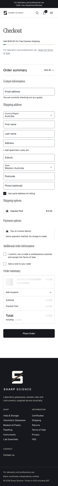

# Sharp Science: pitch demo

A WooCommerce store for an Australian laboratory supplier, built to read like a life-science company rather than a typical online shop.

- **Brand sheet:** [design/brand-sheet.html](../design/brand-sheet.html)
- **Run it:** `npx wp-env start && tools/seed.sh`, then open http://localhost:8888
- **Client guide:** [CLIENT-GUIDE.md](CLIENT-GUIDE.md)

## Screens

| Home | Product | Certificates | Checkout |
|---|---|---|---|
|  |  |  |  |
|  |  |  |  |

All templates at 390px and 1440px are in [screens/](screens/).

## Test results

| Check | Result | Detail |
|---|---|---|
| Entry notice shows once | Pass | 30-day cookie. Plain HTML stays crawlable. |
| Browse without login | Pass | Home, all categories, all products |
| Guest checkout | Pass | Confirmation and timestamp stored on the order |
| Blocked until box ticked | Pass | No order is created without it |
| Countdown 11:59 and 12:01 Perth | Pass | Also Friday and the Christmas holiday run |
| Free shipping at $200.00, not $199.99 | Pass | $199.99 pays $14.95 |
| Lab-use line on every template | Pass | 11 templates |
| Page source: home, product, checkout | Pass | No generator meta, block-library CSS or emoji script |
| Product editing through the admin | Pass | Appears in its category, tile count rises, label and WebP generated |
| CSV export and import | Pass | Import updates by catalogue number |
| Partner note and discount toggles | Pass | Both off by default |
| QR codes on generated labels | Pass | 16 of 16 decode |
| axe | Pass | Zero serious or critical issues. One moderate issue remains on checkout. |
| Home JavaScript | Pass | About 9.5 KB, against a 150 KB budget |
| WordPress detector | **Partial** | Still detected. See below. |

### Lighthouse mobile

| Page | Performance | Accessibility | Best Practices | SEO |
|---|---|---|---|---|
| Home | 99 | 100 | 100 | 100 |
| Category | 100 | 100 | 100 | 100 |
| Product | 99 | 100 | 100 | 100 |
| Certificates | 100 | 100 | 100 | 100 |

Run on the local server with the entry cookie set. Home on a first visit, with the notice showing, scored 99 / 100 / 100 / 100. Live scores depend on hosting.

### What a detector can still find

Simple Wappalyzer reports WordPress, MySQL, PHP, Debian and Apache.

- **WordPress:** asset addresses contain `/wp-content/`, and one `wp-json` address remains in the page script.
- **Direct addresses:** `/wp-login.php` and `/wp-json/` still respond. `/readme.html` responds locally and should be removed at launch.
- **Checkout:** WooCommerce class names and two of its stylesheets remain, overridden by our design. The block checkout cannot lay out without them.
- **Server headers:** the `Server` and `X-Powered-By` headers come from the local Docker image and are set at hosting.

A visitor sees no WordPress or WooCommerce styling or wording on the site. A technical tool can still identify it.

## Requirements

| # | Requirement | How it is met |
|---|---|---|
| 1 | Lab-use language | One setting feeds the top bar, product pages, checkout and footer. Copy scan found no health or medical claims. |
| 2 | Real names and catalogue numbers | Used on the site, labels and CSV |
| 3 | Partner shop note | **Changed:** off, with a blank address. The setting remains. |
| 4 | Lab Essentials | Rack, labels and cleaning solution |
| 5 | Entry notice | **Changed:** trade and professional wording, with no age. Text is a setting. |
| 6 | Policies | Terms linked from footer, product pages, entry notice and checkout. Required checkbox stored with a timestamp. |
| 7 | Shipping notice | Live in Australia/Perth time. Cut-off, weekend and holiday rules are settings. |
| 8 | Free shipping | Threshold setting, with a progress bar in the drawer, cart and checkout |
| 9 | Trust line | "Batch certificates independently verified". The lab name is optional. |
| 10 | Certificates page | Search, category filter, mono table, per-product rows, QR links |
| 11 | No login | Guest checkout on, with no sign-up prompts |
| 12 | AUD including GST | GST is 10%, and prices display inclusive. Australian spelling. |

## Before this goes live

- **Certificates:** the six listed are sample data, marked as such. Real ones must replace them before launch.
- **Legal:** all policy pages are drafts marked [CLIENT TO REVIEW] and need legal review.
- **Standards:** the ISO numbers and product specs are demo values to confirm.
- **Payment:** "Pay on invoice (demo)" is a placeholder. A gateway is needed.

## Open questions

1. What is the live domain? QR codes use it automatically once the site is hosted.
2. What are the real ABN, address and contact details?
3. Which payment gateway and Express Post rate should be used?
4. Which WA public holidays should be listed? The dates in the setting are placeholders to confirm.
5. Is it worth hiding `/wp-content/` from detectors? It needs server rules and adds upkeep.
